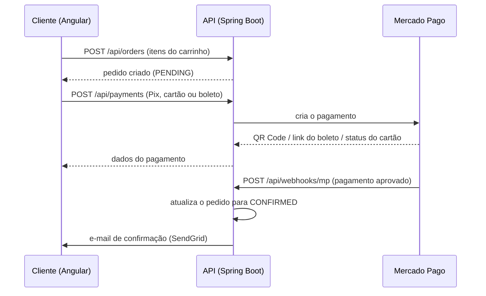

# Pesca Backend — API REST

API REST de um e-commerce de equipamentos de pesca, em Java com Spring Boot. Cuida de autenticação com JWT, catálogo de produtos, pedidos, pagamentos via Mercado Pago (Pix, cartão e boleto), e-mails transacionais e painel administrativo.

> **Projeto de portfólio.** A loja é uma demonstração: nenhum produto é vendido e os pagamentos rodam no ambiente de testes do Mercado Pago.

**[Ver loja no ar](https://pesca-page-46l3.vercel.app)** · **[API no ar](https://pesca-backend-3o69.onrender.com/api/products)** · **[Front-end (Angular)](https://github.com/gustavoVitor504/pesca-page)**

> A API está no plano gratuito do Render. Se ela estiver parada, a primeira requisição pode levar cerca de 1 minuto.

## Funcionalidades

- Cadastro com **verificação de e-mail** e login com **JWT**
- **Controle de acesso por perfil**: clientes navegam e compram; apenas administradores criam, editam e removem produtos
- Catálogo com **busca por nome** e **filtro por categoria**
- Criação de pedidos e histórico de compras do cliente
- **Pagamentos com Mercado Pago**: Pix (QR Code), cartão de crédito e boleto
- **Webhook** que recebe as notificações do Mercado Pago e atualiza o status do pedido
- **E-mails automáticos** com SendGrid: verificação de cadastro e confirmação de pedido
- **Painel administrativo**: dashboard com indicadores, gestão de produtos e atualização do status dos pedidos

## Tecnologias

- Java 17 e Spring Boot 3.4
- Spring Security e JWT (jjwt)
- Spring Data JPA e Hibernate
- PostgreSQL (Supabase)
- Bean Validation
- SDK Java do Mercado Pago
- SendGrid
- Lombok e Maven
- Docker
- Deploy: API no Render, front-end na Vercel, banco no Supabase

## Arquitetura

A API é organizada em camadas, cada uma com uma responsabilidade:

```
src/main/java/com/example/pesca/
├── config/        # SecurityConfig: rotas públicas e protegidas, CORS, filtro JWT
├── controller/    # recebe as requisições HTTP
├── service/       # regras de negócio (auth, pedidos, pagamentos, e-mail, admin)
├── repository/    # acesso ao banco com Spring Data JPA
├── model/         # entidades: User, Product, Order, OrderItem
├── dto/           # objetos de entrada e saída da API
└── security/      # geração e validação de tokens, filtro de autenticação
```

### Fluxo de pagamento



## Endpoints

### Autenticação — público

| Método | Rota | Descrição |
|---|---|---|
| POST | `/api/auth/register` | Cadastra o usuário e envia o e-mail de verificação |
| POST | `/api/auth/login` | Faz login (só para e-mails verificados) e devolve o token JWT |
| GET | `/api/auth/verify?token=...` | Confirma o e-mail e redireciona para o front-end |

### Produtos

| Método | Rota | Acesso |
|---|---|---|
| GET | `/api/products` | público — aceita `?category=Varas` ou `?search=shimano` |
| GET | `/api/products/{id}` | público |
| POST | `/api/products` | ADMIN |
| PUT | `/api/products/{id}` | ADMIN |
| DELETE | `/api/products/{id}` | ADMIN |

### Pedidos e pagamentos — requer token

| Método | Rota | Descrição |
|---|---|---|
| POST | `/api/orders` | Cria um pedido a partir dos itens do carrinho |
| GET | `/api/orders` | Lista os pedidos do usuário logado |
| POST | `/api/payments` | Gera o pagamento do pedido no Mercado Pago |

### Administração — ADMIN

| Método | Rota | Descrição |
|---|---|---|
| GET | `/api/admin/dashboard` | Total de pedidos, pendentes, confirmados, faturamento, produtos e usuários |
| GET | `/api/admin/products` | Lista todos os produtos |
| POST | `/api/admin/products` | Cadastra produto |
| PUT | `/api/admin/products/{id}` | Edita produto |
| DELETE | `/api/admin/products/{id}` | Remove produto |
| GET | `/api/admin/orders` | Lista todos os pedidos |
| PUT | `/api/admin/orders/{id}/status` | Atualiza o status (`PENDING`, `CONFIRMED`, `SHIPPED`, `DELIVERED`, `CANCELLED`) |

### Webhook — público

| Método | Rota | Descrição |
|---|---|---|
| POST | `/api/webhooks/mp` | Recebe notificações de pagamento do Mercado Pago |

Nas rotas protegidas, envie o header `Authorization: Bearer SEU_TOKEN`.

## Segurança

- Senhas armazenadas com **BCrypt**
- Autenticação **stateless** com JWT, sem sessão no servidor
- Autorização por perfil (`ROLE_USER` e `ROLE_ADMIN`) definida no `SecurityConfig`
- Login bloqueado até o e-mail ser verificado
- CORS restrito às origens configuradas por variável de ambiente
- Nenhuma credencial no código: tudo vem de variáveis de ambiente (`.env` fora do Git)

## Como rodar localmente

Pré-requisitos: Java 17+, um projeto no [Supabase](https://supabase.com), uma conta de desenvolvedor no [Mercado Pago](https://www.mercadopago.com.br/developers) e uma conta no [SendGrid](https://sendgrid.com).

1. Clone o repositório:

```bash
git clone https://github.com/gustavoVitor504/pesca-backend.git
cd pesca-backend
```

2. Copie o `.env.example` para `.env` e preencha os valores (veja a tabela abaixo).

3. Em `src/main/resources/application.properties`, ajuste `spring.datasource.url` e `spring.datasource.username` com os dados do seu projeto no Supabase (**Connect → Session pooler**).

4. Inicie a aplicação:

```bash
./mvnw spring-boot:run
```

A API sobe em `http://localhost:8080` e o Hibernate cria as tabelas automaticamente.

### Variáveis de ambiente

| Variável | Descrição |
|---|---|
| `PASSWORD` | Senha do banco PostgreSQL (Supabase) |
| `JWT_SECRET` | Chave para assinar os tokens JWT (mínimo de 256 bits) |
| `MP_ACCESS_TOKEN` | Access Token do Mercado Pago (use o de teste) |
| `SENDGRID_API_KEY` | Chave da API do SendGrid |
| `SENDGRID_FROM_EMAIL` | E-mail remetente verificado no SendGrid |
| `FRONTEND_URL` | URL do front-end, usada nos links dos e-mails (padrão: `http://localhost:4200`) |
| `CORS_ALLOWED_ORIGINS` | Origens permitidas, separadas por vírgula (padrão: `http://localhost:4200`) |
| `DDL_AUTO` | Estratégia do Hibernate para o schema (padrão: `update`; em produção, `none`) |

Para gerar um `JWT_SECRET`:

```bash
# Linux/macOS
openssl rand -base64 64
```

```powershell
# Windows (PowerShell)
$b = New-Object byte[] 64; [Security.Cryptography.RandomNumberGenerator]::Create().GetBytes($b); [Convert]::ToBase64String($b)
```

## Deploy

A API roda em um container Docker no Render. O `Dockerfile` usa build em dois estágios (Maven para compilar e JRE para executar) e opções de JVM ajustadas para instâncias com pouca memória e CPU.

## Autor

**Gustavo Vitor Ferreira Nunes** — [LinkedIn](https://www.linkedin.com/in/gustavovitorferreira/) · [GitHub](https://github.com/gustavoVitor504)
